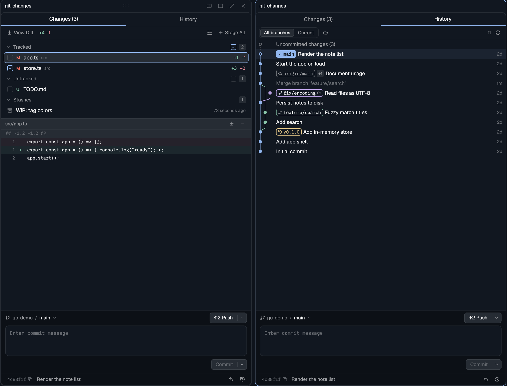

# Changes for Herdr

A git panel for the [Herdr](https://herdr.dev) desktop app, laid out like
[Zed](https://zed.dev)'s git panel. You stage files with checkboxes, then
commit, amend, stash, pull and push from the panel, read the diff of whatever
you pick, and browse the history as a commit graph. It follows the repository
of the terminal you're focused on.

It replaces the Changes panel that ships with Herdr. That panel lists files
and shows diffs; its only action is a single Commit that stages everything
first.



## What it does

### Changes tab

- **Files grouped like Zed's:** Conflicts, Tracked, Untracked, then your
  Stashes. Each file has a checkbox that stages it, unstages it, or shows `−`
  when only part of it is staged. Each group header has a checkbox for the
  whole group.
- **Toolbar:**
  - View Diff opens every change in its own tab.
  - Stage All / Unstage All.
  - The ☰ menu: stash everything, stash only what's staged, pop the latest
    stash, discard tracked changes, trash untracked files.
- **On a file:** click it to preview its diff under the list; double-click it
  to open the diff in a tab. Hover to get *Open diff in a tab* and *Discard*.
  Right-click to stage, copy its path, or discard it.
- **On a stash:** hover to Apply, Pop or Drop it; click to see its diff, new
  files included.

### Commit area

- **The branch row** shows `repo / branch ⌄`. Click it to switch to another
  local branch.
- **The remote button** picks what makes sense now: `↓N Pull` when you're
  behind, `↑N Push` when you're ahead, Publish for a branch with no upstream,
  else Fetch. Its ⌄ menu has Fetch, Pull, Pull (rebase), Push and
  Force push (with lease).
- **The message box** is multi-line. ⌘↩ commits. With one changed file it
  suggests a message, as Zed does (`Update store.ts`).
- **Commit or Commit Tracked:** the button commits what's staged. When nothing
  is staged it reads *Commit Tracked* and runs `git commit -a`. Its ⌄ menu has
  Amend (pre-filled with the last message), Signoff, Commit & push, Stash all
  and Uncommit.
- **The last commit** sits at the bottom with its short hash (click to copy the
  full one), ↶ Uncommit (the changes stay staged) and a jump to History.

### History tab

A commit graph drawn the way [herdr-git-graph](#credits) draws it:

- Colored lanes, with curves where branches fork and merge.
- Labels for branches (✓ on the checked-out one, a cloud when it's pushed),
  remote branches and tags.
- HEAD drawn as a ring, and your uncommitted changes as a dashed top row.

Controls:

- **All branches / Current** in the toolbar.
- **☁** shows every remote branch. Off by default: only your branch's upstream
  shows, because remote branches you don't work on each take a lane.
- **The graph's width** is capped at about a quarter of the panel. When the
  panel is narrow the lanes move closer together, down to 6px apart; past that
  the outer ones are cut off. A row shows one label and folds the rest into
  `+N`.
- **Clicking a commit** previews its diff; double-click opens it in a tab;
  ⌘C copies its hash.
- **Right-click a commit** to check out a branch on it, a remote branch
  (tracking it) or the commit itself, open its diff, copy its hash, short hash
  or message, revert it, or uncommit it if it's the last one.
- **Paging:** 300 commits at first, 300 more each time you scroll to the end.

### Safety

Discard, Drop, Trash and Force push are destructive. They ask once more in
place: the button turns into *Sure?*, or the menu item into *Click again*.
Nothing else asks. When git refuses, its own message appears under the list.
Push, pull and fetch failures also show as a notification.

## What it runs

The mod runs `git` in the focused terminal's repository. For a space on another
machine, it runs git on that machine. It also reads files there to preview an
untracked file. Every git call is an argument list, never a shell line. Reads
use `--no-optional-locks` and leave the index alone, so the panel's own refreshes
don't wake its file watcher.

It reaches the network only through git, when you Fetch, Pull or Push. It reads
and writes nothing outside the repository and Herdr's own state.

## Install

Ask your Herdr agent:

> add the mod at github.com/aBER0724/herdr-git-changes

It reads [RECIPE.md](RECIPE.md), copies `mods/git-changes/` into
`~/.config/herdr-app/mods/`, and runs `herdr-app check` on it.

By hand:

```sh
git clone https://github.com/aBER0724/herdr-git-changes
cp -R herdr-git-changes/mods/git-changes ~/.config/herdr-app/mods/
herdr-app check ~/.config/herdr-app/mods/git-changes
```

### Use it as your Changes panel

Herdr's own layouts are read-only. Clone the one you use, then point its
`changes` block at this mod:

```sh
herdr-app do layout.clone '{"name":"main","as":"my-main"}'
```

In `~/.config/herdr-app/layouts/my-main.json`, find the block with
`"id": "changes"` (inside the `panel-body` stack) and change its content:

```json
{ "id": "changes", "type": "block", "content": { "mod": "git-changes" } }
```

The tab bar's Changes button now opens this panel.

Keep the `panel` column around `panel-body`. The tab bar shows and hides the
panel through it, and without it every click toasts
`layout.show failed: no node "panel"`.

### Or open it as a pane or a tab

On one repository, whatever is focused:

```sh
herdr-app do pane.split '{"direction":"right","mod":"git-changes","props":{"folder":"/path/to/repo"}}'
herdr-app do tab.new '{"name":"History","mod":"git-changes","props":{"folder":"/path/to/repo","tab":"history"}}'
```

| Prop | Meaning |
|---|---|
| `folder` | Show this repository instead of the focused terminal's. |
| `on` | With `folder`: the machine it's on (a name from `hc machine ls`). |
| `tab` | Open on `"changes"` or `"history"`. Without it, the panel opens on the tab you used last. |

## Limits

- Tested on macOS with Herdr 0.1.11. Linux and Windows aren't tested.
- Whole files only: no staging of single hunks or lines yet.
- Renames show as a delete and an add (status runs with `--no-renames`).
- At most 1,000 changed files are listed. A preview shows up to 5,000 diff
  lines; an untracked file's preview stops at 3,000 lines.
- No branch creation, merge, rebase, cherry-pick or tags from the panel; use
  [herdr-git-graph](https://github.com/rabeeh-ta/herdr-git-graph) for those.
- `herdr-app check` renders the panel once, before any git output arrives, so
  it can't catch errors in the rows. Test in the app too.

## Development

```sh
node tests/git.test.mjs
```

The tests build throwaway repositories with a bare "remote". They run every
command a button or menu item runs against real git, then check the parsing,
the commit modes, the remote button's choice, stashes, uncommit, force push,
checkout and the history graph (lanes, labels, the remote toggle). They don't
need Herdr. CI runs them on every push.

While editing, copy the folder over the installed one and check it:

```sh
rsync -a mods/git-changes/ ~/.config/herdr-app/mods/git-changes/
herdr-app check ~/.config/herdr-app/mods/git-changes
```

Files in `mods/git-changes/`:

| File | What's in it |
|---|---|
| `main.js` | Picks a role from `props.role`: the panel, a menu, or a diff tab. |
| `panel.js` | The panel: reading the repository, every action, the Changes tab and the commit area. |
| `history.js` | The History tab's graph. |
| `lanes.js` | Lays commits out on lanes (from herdr-git-graph, unchanged). |
| `diff.js` | Loading and drawing diffs, and the diff tab. |
| `menu.js` | The dropdown and right-click menus, shown as popups. |
| `git.js` | Parsing git's output and the argv behind every action. No Herdr imports, so node can test it. |

## Credits

This mod reuses code from two projects and copies the layout of a third.
Each file that holds borrowed code says so at its top.

**[herdr-git-graph](https://github.com/rabeeh-ta/herdr-git-graph)** by
Rabeeh T A, MIT License. The History tab is built on it:

- `lanes.js` is its `mods/git-graph/lanes.js`, copied unchanged.
- `history.js` follows its `graph.js` for drawing a row's graph: one stroked
  path per color, the curve between lanes, the HEAD ring, the lane colors, the
  label look, whole-pixel rows and paging.
- `git.js` follows its `git.js` for parsing refs, the history's scope, the
  uncommitted row, pairing a branch with its remote, and trimming git's errors.
- `menu.js` follows its `menu.js` for the menu's look and keys.
- Most icons are its icons (Lucide, below).
- The panel listens to its `git-graph.changed` signal and sends the same one,
  so with both installed, an action in either refreshes the other.

Its license is in [LICENSES/MIT-herdr-git-graph.txt](LICENSES/MIT-herdr-git-graph.txt).

**Herdr's Changes panel** ([herdr.dev](https://herdr.dev)), Apache License 2.0.
This mod started as `herdr-app do mod.clone '{"name":"changes"}'` of the panel
shipped with Herdr 0.1.11 (`mod.json` still records `cloned_from`).

- Kept from it: how the panel finds the focused repository, the folder watch,
  the context-keyed refresh, the read-only git flags, and the diff row.
- Changed or added: everything else. Staging, the commit area, stashes,
  remotes, history, menus and the diff tab are new.

Apache 2.0 text: [LICENSES/Apache-2.0.txt](LICENSES/Apache-2.0.txt).

**[Lucide](https://lucide.dev)**, ISC License. The icons are Lucide's, as
herdr-git-graph and Herdr draw them; `chevron-*.svg` come from Herdr's Files
panel. `diff`, `history`, `minus`, `sliders` and `undo` were added here from
Lucide. See [LICENSES/ISC-Lucide.txt](LICENSES/ISC-Lucide.txt).

**[Zed](https://zed.dev)**'s git panel is the model for the layout: the
Changes/History tabs, the staging checkboxes, Commit vs Commit Tracked, the
branch row's remote button and the suggested commit message. No Zed code is
used.

## License

MIT, see [LICENSE](LICENSE). The borrowed parts keep their own licenses, listed
under [Credits](#credits).
