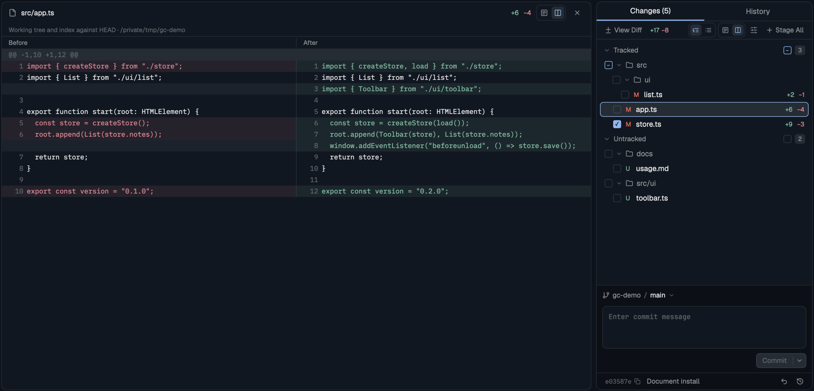

# Git Changes

A git panel for the focused terminal's repository, laid out like Zed's git
panel. It has a Changes tab and a History tab. In Changes you stage files with
checkboxes and work with stashes; the files show as a folder tree or a flat
list. In History you browse a commit graph drawn like herdr-git-graph's.
Clicking a file, stash or commit opens its diff in the main area, in one diff
tab per space, in one column or two (before | after). A commit area sits at the
bottom of both tabs: the branch, a remote button that pulls, pushes, publishes
or fetches, a multi-line message, a split Commit button, and the last commit
with a copyable hash. It replaces Herdr's `changes` block in a layout, and also
opens as a pane or a tab on one repository.

## What you see

One column on `background`, radius 10, 1px `border`, base text 13px, top to
bottom:

- **Tabs**, 34px, bottom border: `Changes (N)` and `History`, each half the
  width, 13px. The current one is `foreground` with a 2px `accent` underline,
  the other `muted`.
- **Toolbar**, 32px, 8px side padding, bottom border, 22px icon buttons in
  `muted`.
  - On Changes: `± View Diff`, the `+N −N` totals in `ansi2` and `ansi1` 11px,
    a gap, two icon pairs, a ☰ (sliders icon) menu button, then `+ Stage All`.
    That last button reads `− Unstage All` when everything is staged.
  - Each icon pair is a rounded box (radius 7, 1px `border`, 2px padding) of
    two 20px cells with 12px icons. The chosen cell is `selected` with an
    `accent` icon; the other is `muted`. The first pair is Tree (list-tree) or
    Flat (list); the second is One column (rows) or Two columns (columns).
  - On History: a segmented control `All branches | Current` (20px segments,
    11.5px, the chosen one `raised` with a border), a ☁ toggle (`selected`
    background and `accent` icon when on), the commit count in 11px `dim` on
    the right (`300+` when there are more), and Refresh.
- **The list.**
  - On Changes, rows are 26px, radius 6, 6px padding around the list. Group
    headers show a chevron, the title at 12px `muted`, a 14px checkbox and a
    count chip (`raised`, 10.5px). The groups are Conflicts, Tracked,
    Untracked and Stashes, and empty ones are left out.
  - A file row shows: a 14px checkbox (3px radius, `input` border; `accent`
    filled with ✓ when staged, `accent` `−` when partly staged); the status
    letter 11px (`blocked` for M, `ansi2` for A and U, `ansi1` for D and
    conflicts); the file name; and `+N −N` on the right. In Flat, the folder
    follows the name in 11px `dim`.
  - In Tree, files sit under folder rows, indented 14px per level. A folder
    row shows a checkbox (all, some or none staged inside), a chevron, a folder
    icon and the name in `muted`. A folder holding only one folder is merged
    with it (`src/ui`). A folded folder shows its file count on the right.
  - Hovering a file swaps the counts for a 22px discard button (`ansi1`).
  - The row the diff tab shows is `selected` with a 1px `accent` border.
  - A stash row shows a stash icon, its message, and its age in 11px `dim`.
    Hovering it shows Apply, Pop and Drop.
  - With no changes: "No changes to commit", centered, `dim`, and
    "N commits to push" under it when the branch is ahead.
- **History rows**, 24px each, a virtual list.
  - The graph cell: lanes 5px in from the left and up to 12px apart. The cell
    is at most 26% of the panel width, between 28 and 110px. When the lanes
    don't fit, they get closer (down to 6px apart) and the dots shrink from
    8px to 6px. Past that, the outer lanes are cut off.
  - Lines are 1.5px (1.25px when lanes are tight), in lane colors
    `ansi4, ansi2, ansi5, ansi3, ansi6, ansi1, ansi12, ansi10, ansi13, ansi11, ansi14, ansi9`.
    A change of lane is a cubic curve with vertical tangents.
  - HEAD's dot is a ring, and its row is tinted with its lane color at 8%.
  - The top row is "Uncommitted changes (N)", in `muted`, with a gray ring and
    a dashed line to HEAD.
  - Labels are 18px tall, radius 5, monospace 11px, at most 36% of the text
    width. The checked-out branch is filled with its lane color and has a ✓.
    Other branches have a lane-color border and a branch icon, plus a cloud
    when their remote twin exists. Remote branches are `muted` with a cloud;
    tags are `ansi3` with a tag icon.
  - Only the first label shows. The rest fold into a `+N` chip (`raised`) whose
    tooltip lists them.
  - The subject follows the labels; merge commits are `dim`. The date is 11px
    `dim` on the right: `now`, `5m`, `3h` or `2d`, else `Sep 7`, with the year
    once it isn't this year.
- **The diff tab**, in the main area, a tab of its own named after what it
  shows (`app.ts`, `stash@{0}`, a short hash), on `background`:
  - A 38px header: a file, stash or commit icon, the path or subject in
    semibold, `+N −N`, the One/Two-column pair (22px cells), and a 24px ×.
  - A 22px line under it in 11px `dim`: what's compared (`Working tree and
    index against HEAD`, `Commit <hash> · <author> · <when>`, `Stash <ref>`)
    and the repository path, with `Loading…` on the right while loading.
  - One column: monospace 12px, 20px rows. Two 38px `dim` gutters (old and new
    line numbers), the `+`/`−` sign in `ansi2`/`ansi1`, then the text. Added
    lines have an `ansi2` background at 9%, removed ones `ansi1` at 9%.
  - Two columns: a 22px `Before | After` header in 11px `muted`, then two equal
    halves split by a 1px `border`. Each half has one 38px gutter: old numbers
    on the left, new on the right. An empty cell opposite an unmatched line is
    `raised` at 53%.
  - Hunk headers are `raised` and `dim`, across both columns. When a diff
    covers several files, each file starts with a 24px header in bold on
    `raised`.
- **A note**, 11px `ansi1`, above the commit area when git refuses something.
  Click it to dismiss.
- **The commit area**, on `chrome` with a top border:
  - The branch row, 34px: a branch icon, the repository name in `muted`, a
    `/`, the branch name, and a ⌄. On the right, the remote button: a 26px
    split button, `raised` with a border, whose main half reads `↓3 Pull`,
    `↑15 Push`, `Publish` or `↻ Fetch`.
  - The message box: multi-line, monospace 12px, 3 to 10 rows, radius 8, its
    border `accent` while typing. The placeholder is the suggested message, or
    "Enter commit message".
  - Then `amend` and `signoff` chips when they're on, and the Commit split
    button on the right: `solid` with `solid_foreground`, reading `Commit`,
    `Commit Tracked` or `Amend`.
  - The last commit, 30px, top border: a hash chip (monospace 11px `dim`, the
    7-character hash and a copy icon; ✓ in `ansi2` for 1.5s after a copy), the
    subject in `muted`, then 22px Uncommit (↶) and History (🕘) buttons.

Menus are popups on `popover` with 28px rows: an icon or a ✓, the label, and a
hint in 11px `dim`. Danger items are `ansi1`.

## How it behaves

- **Where it looks.** The focused pane's live folder, else the focused block's
  terminal, else the space's folder. With `props.folder` (and `props.on`), only
  that repository. Each read starts with `git rev-parse --show-toplevel`; when
  that fails, the panel shows "Not a git repository".
- **Staying current.**
  - It refreshes whenever its folder changes (`watchFolder`), every 10s, when
    the focus moves to another folder, and after every action.
  - Folders on other machines are polled instead of watched.
  - It sets and listens to `shared("git-graph.changed")`, so herdr-git-graph
    refreshes after this panel acts, and the other way round.
  - Reads use `--no-optional-locks -c core.fsmonitor=false -c
    diff.autoRefreshIndex=false`, so they don't wake the watch.
- **Agent status** isn't shown; this panel is about one repository.
- **Clicks.**
  - Clicking a file, stash, commit, the uncommitted row or View Diff shows it
    in the main area: `showInTab()` writes `shared("git-changes.view")[space]
    = { item, source: { root, on }, at, tab, opening }`.
    - If that space's diff tab is still open, it's renamed and selected.
    - Otherwise `tab.new {space, name, mod: "git-changes", props: { role:
      "diff", space }}` makes one. A click within 1.5s of asking waits for it
      instead of making a second tab.
    - The tab reads its entry, and on first sight writes its own tab id into
      it (the tab in that space holding a `git-changes` pane, the shown one
      first).
    - Closing the tab leaves a stale id; the next click finds the tab gone and
      makes a new one.
  - A folder row toggles folding. A checkbox stages or unstages without opening
    the file.
  - A group's or a folder's checkbox stages everything in it, or unstages it
    when all of it is staged.
  - The Tree/Flat and One/Two-column pairs switch at once. The column choice is
    `shared("git-changes.layout")`, so the panel's pair and every diff tab's
    pair stay in step.
  - Right-click menus:
    - File: stage or unstage, Show diff, copy path, copy full path, and
      Discard (danger).
    - Stash: Apply, Pop, Show diff, and Drop (danger).
    - Commit: checkout each local branch on it, checkout each remote-only
      branch with tracking, checkout this commit (detached), Show diff, copy
      hash (⌘C), copy short hash, copy message, Uncommit (last commit only),
      and Revert.
  - In History, right-clicking the uncommitted row opens the ☰ menu.
- **Keys.** ⌘↩ (or ctrl-↩) commits. ⌘C (or ctrl-shift-c) copies the hash of
  the commit the diff tab shows, except while the message box has the
  keyboard. Esc leaves the message box. In menus: ↑/↓, ↩ or space, Esc. In two
  columns, a sideways scroll (trackpad, or Shift+wheel) moves both columns'
  text together.
- **The diff tab follows the files.** It watches the repository (local) or
  polls it every 10s, and reloads, except for a commit, which can't change.
  A pick that arrives while one is loading is loaded right after.
- **Where the panel looks while the diff tab is focused.** The diff tab is a
  mod pane with no folder. When the focused pane is it, the panel keeps the
  repository the tab shows, instead of falling back to the space's folder.
- **The Commit button.**
  - With anything staged it reads `Commit` and runs `git commit -m`. With
    nothing staged but tracked changes, it reads `Commit Tracked` and runs
    `git commit -a`. With only untracked files, it's disabled. Conflicts
    disable it too, and the note says to stage each file once it's resolved.
  - An empty message uses the suggestion. With one file, that's
    `Update|Create|Delete <name>`.
  - Amend pre-fills the whole last message; an empty amend keeps the last
    message (`--no-edit`).
  - Commit & push adds `--force-with-lease` when amending a commit that's
    already pushed.
- **The remote button.**
  - With no remote it's hidden.
  - It reads `↓N Pull` when behind (`git pull --ff-only`), `↑N Push` when ahead
    (`git push`), `Publish` with no upstream (`git push --set-upstream origin`,
    or the only remote, then the branch), else `Fetch` (`git fetch --prune`).
  - Its menu adds Pull (rebase) and Force push (with lease).
  - Remote work shows a toast when done or failed.
- **Danger.** Discard, Drop, Trash untracked, Discard tracked and Force push
  ask again. Inline buttons turn red and read "Sure?" for 3s; menu items turn
  red and read "Click again: …". Nothing else asks.
- **Busy.** One action runs at a time; the buttons read `Committing…`,
  `Push…` and so on. The refresh after an action waits for it to finish.
- **History.**
  - It's read only while the tab shows. All branches runs
    `--all --exclude=refs/stash`. With ☁ off it adds
    `--exclude=refs/remotes/*` and then the upstream's own ref; Current reads
    `HEAD`.
  - 300 commits are read first, and 300 more when the list scrolls to its end.
  - Each panel copy remembers (in its `localStorage`): the last tab, All or
    Current, ☁, Signoff, which groups and folders are folded, and Tree or
    Flat.
- **Motion.** None; nothing animates.

## Built from

- **Layout.** A block with `{ "mod": "git-changes" }`. In a clone of Herdr's
  `main` layout, that's the `changes` child of the `panel-body` stack, inside
  the `panel` column the tab bar shows and hides. The choice is per layout
  file: every layout the person switches between needs its `changes` block
  pointed here, or that layout keeps Herdr's panel. Herdr's own `main` is
  read-only, so clone it first (`layout.clone`). When installing, list the
  person's layouts that still say `"mod": "changes"` and offer to switch each.
- **Roles** (`props.role`):
  - none: the panel.
  - `"menu"`: a popup with `{ owner, items }`.
  - `"diff"`: the diff tab, with `{ space }`. What it shows comes from
    `shared("git-changes.view")[space]`, not from props, so one tab serves
    every later pick.
- **Panel props:** `folder`, `on`, and `tab` (`"changes"` or `"history"`).
- **Files:**
  - `main.js`: picks the role.
  - `panel.js`: state, refresh, actions, the Changes tab (tree and flat) and
    the commit area.
  - `history.js`: the graph.
  - `lanes.js`: lane layout, copied unchanged from herdr-git-graph.
  - `diff.js`: loading diffs, `showInTab()`, and the diff tab with its one-
    and two-column views.
  - `menu.js`: menus.
  - `git.js`: parsing, `fileTree()` (folders first, single-folder chains
    merged, folded paths skipped), `splitRows()` (removed and added lines
    paired by position inside a block), and every argv. No Herdr imports, so
    `node` can test it.
- **Menus.** A menu can't run git itself: a popup's tasks end when it closes.
  It posts `setShared("git-changes.pick", { owner, id, at })`, and the panel
  whose `owner` id matches runs the action it remembered under that id.
  Clipboard items copy in the popup.
- **Git:**
  - status: `status --porcelain=v2 --branch -z --no-renames --untracked-files=all`
  - counts: `diff HEAD --numstat -z` (before the first commit, `--cached` and
    the worktree, added up)
  - stashes: `stash list --format=%gd%x1f%s%x1f%cr`
  - history: `log --date-order --decorate=full -n<limit>`
  - previews: `diff HEAD -- <path>`, `stash show -p --include-untracked <ref>`,
    `show --format= -p --diff-merges=first-parent <hash>`
  - Every action is an argv list in `git.js`.
- **Herdr:** `spaces`, `panes`, `focused`, `exec`, `readTextFile`,
  `watchFolder`, `theme`, `settings`, `notify`, `shared`, `setShared`,
  `openOverlay`, `closeOverlay`, `props`, and `run` for `tab.new`,
  `tab.rename`, `tab.select`, `tab.close`.
- **gpui:** `TextareaState` and `Textarea`, `v_virtual_list`, `Scrollbar`,
  `PathBuilder` with `window.paint_path`, and `write_to_clipboard`.
- **Art:** Lucide icons in `icons/` (ISC). Most come from herdr-git-graph;
  `chevron-*` come from Herdr's Files panel.

## Watch out

- **A method and a field must never share a name.** `this.labels = new Map()`
  replaced a `labels()` method, and every History row threw. `herdr-app check`
  passed, because it renders once before git answers, with no rows.
- **Popup tasks are cancelled on close**, so actions run in the panel, not the
  menu.
- **Virtual-list rows can't hold their own handlers.** Use `on_item_click` and
  `on_item_secondary_click` on the list. Take the click count from an
  `on_mouse_down` on a wrapper.
- **`paint_path` takes raw pixels** while elements are zoomed. Multiply the
  path's coordinates by `settings().zoom`.
- **Rows must be a whole number of screen pixels.** Round `24 × zoom` and
  divide back; 21.6px rows leave hairlines between them.
- **The tab bar runs `layout.show {id: "panel"}`.** A layout whose
  `panel-body` stack isn't wrapped in a `panel` column toasts on every click
  and every space switch.
- **Remote branches each take a lane.** In one repository, 300 commits needed
  16 lanes with them and 7 without. That's why ☁ is off by default.
- **Submodules** have no hunks: their diff is the `Subproject commit` lines
  or "Submodule: untracked content".
- **Two columns need one list.** Two virtual lists side by side drift apart
  as they scroll. Pair the rows first, then draw each pair as one row with
  both halves. Sideways scrolling is an offset applied to both texts; the
  gutters stay put.
- **A mod can't import another mod's files**, not even for a test helper:
  `herdr-app check` refuses paths outside its folder.
- **Limits:**
  - 1,000 changed files.
  - 5,000 diff lines; an untracked file shows its first 3,000 lines.
  - Lines past 4,000 characters are cut.
  - Whole-file staging only; renames show as a delete and an add.
- **Assumptions:** git 2.35 or newer (`git stash push --staged`), and Herdr
  0.1.11. Tested only on macOS.

## Done when

- `herdr-app check mods/git-changes` passes.
- In every layout the person uses, the tab bar's Changes button opens this
  panel, not Herdr's. `grep -l '"mod": *"changes"' layouts/*.json` lists only
  Herdr's own read-only `main.json`, or nothing.
- `node tests/git.test.mjs` passes. It runs every action against throwaway
  repositories with a bare remote.
- `node tests/ui.test.mjs` passes. It renders the panel and the diff tab,
  every row included, and clicks through them.
- Clicking a file opens a tab in the main area named after it, showing its
  diff. Clicking another file renames and reuses that tab. After closing it,
  the next click opens a new one.
- The Two-columns pair shows `Before | After`. A block of 2 removed and 1 added
  lines makes 2 rows: the first pairs, the second has an empty right side.
- Tree shows `src/ui` merged into one row when `src` holds nothing else.
  Folding it hides its files. Flat shows each file with its folder beside it.
- In a repository with a staged file, a partly staged file and an untracked
  file:
  - the checkboxes read ✓, `−` and empty;
  - the button reads `Commit`;
  - committing leaves the other two.
- With nothing staged, the button reads `Commit Tracked`, and committing leaves
  only untracked files.
- Stash with a message, then Pop: the files come back, and the stash's diff
  showed the untracked file too.
- On a branch with no upstream, the remote button reads `Publish`. After it,
  one commit later, it reads `↑1 Push`.
- History draws a merge as two lanes joined by a curve, puts `✓ main` first on
  HEAD's row, and has a dashed line from the uncommitted row to HEAD.
- Turning ☁ on or off adds or removes a remote-only branch's lane.
- ⌘C, with a commit in the diff tab, puts its 40-character hash on the
  clipboard.
